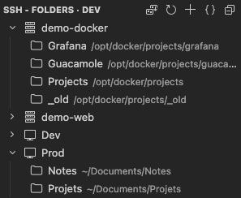
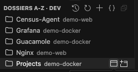
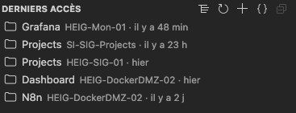

# SSH - Folders

Liste les hôtes SSH et des dossiers distants favoris. Remote-SSH ouvre la connexion. Les dossiers locaux du poste se rangent sous un `VirtualHost`.

[English below.](#english)

## What's New

Dernière version uniquement. Historique complet : onglet **Changelog** du Marketplace (`CHANGELOG.md`).

<!-- latest-changelog:start -->
### 0.3.0

- Dossiers locaux du poste de base via `local[]` et `VirtualHost` (serveurs virtuels, ouverture `file://`).
- Ajout d'un dossier local : parcours navigable à partir de `~/`.
- Masquage d'hôtes : `defaults.HiddenHosts` (ex. `gitlab*`).
- Fin de liste : `defaults.LastFolder` (ex. `Projects`, `_old`).
- Regroupement A-Z désactivable : `defaults.GroupSameName`.
- Tri alphabétique : `defaults.SortAlphabetical` (vrai par défaut).
- Couleur de l'entrée active : thème `sshFolders.activeForeground` (réglage via `workbench.colorCustomizations`, pas via le JSON des favoris).
- Clés `defaults` manquantes ajoutées au JSON au chargement.
<!-- latest-changelog:end -->

## Français

### Aperçu

Fichier d'exemple : `examples/ssh-folders.example.json` (`demo-docker` / `demo-web` = SSH fictifs ; `Prod` / `Dev` = locaux).

Icônes : **server** = hôte SSH · **device-desktop** = VirtualHost local · **symbol-folder** = dossier (distant ou local ; le local se distingue par `· local`).

### Fonctionnalités

- Hôtes depuis `~/.ssh/config` (ou `remote.SSH.configFile`).
- Favoris distants → Remote-SSH ; locaux → ouverture `file://` sous un `VirtualHost`.
- Trois vues : par hôte, A-Z, derniers accès.
- Ajouter / renommer / supprimer depuis l'arbre ; ouvrir dans la fenêtre courante ou une nouvelle.

### Installation

1. Extensions → chercher `cedric217.ssh-folders`.
2. Installer aussi **Remote - SSH** (connexion distante).

### Configuration

#### 1. Ouvrir le JSON

Bouton `{}` en haut de la vue, ou commande *Ouvrir la config des dossiers*.

Fichier par défaut : `~/.ssh/extensions/ssh-folders.json`  
(autre chemin : réglage `sshFolders.configPath`)

Au premier lancement, l'extension crée le fichier et copie le schéma à côté. Les clés `defaults` manquantes sont ajoutées sans écraser l'existant.

#### 2. Minimal utile

~~~json
{
  "$schema": "./remote-folders.schema.json",
  "defaults": {
    "DefaultFolder": "/opt/docker/projects"
  },
  "local": [
    { "VirtualHost": "Prod", "path": "~/Documents/Projets", "label": "Projets" }
  ],
  "folders": {
    "mon-serveur": [
      { "path": "/opt/docker/projects/grafana", "label": "Grafana" }
    ]
  }
}
~~~

| Champ | Rôle |
| --- | --- |
| `folders.<Host>` | Favoris distants. Clé = alias `Host` du SSH config (pas le `HostName`). Chemin POSIX absolu (`/...`). |
| `local[].VirtualHost` | Nom du groupe local affiché comme un serveur. |
| `local[].path` | Chemin local absolu ou `~/...` (dossiers seulement). |
| `local[].label` / `folders[].label` | Libellé affiché (sinon nom du dossier). |

#### 3. Options `defaults` (courantes)

| Clé | Défaut | Effet |
| --- | --- | --- |
| `DefaultFolder` | — | Préremplit le `+` ; clic hôte ouvre ce chemin. |
| `RecentLimit` | `20` | Taille de la vue derniers accès (1–100). |
| `SortAlphabetical` | `true` | Tri A-Z des hôtes et dossiers. |
| `GroupSameName` | `true` | Regroupe les noms proches en vue A-Z. |
| `HiddenHosts` | `[]` | Masque des alias (`gitlab*`, …). |
| `LastFolder` | `Projects`, `_old` | Libellés placés en fin de liste. |

#### 4. Couleur de l'entrée active

Pas dans le JSON. Settings de l'éditeur :

~~~json
"workbench.colorCustomizations": {
  "sshFolders.activeForeground": "#3fb950"
}
~~~

## English

### Overview

Sample file: `examples/ssh-folders.example.json` (`demo-docker` / `demo-web` = fictional SSH hosts; `Prod` / `Dev` = local groups).

Icons: **server** = SSH host · **device-desktop** = local VirtualHost · **symbol-folder** = folder (remote or local; local shows `· local` in the description).

### Features

- Hosts from `~/.ssh/config` (or `remote.SSH.configFile`).
- Remote favorites → Remote-SSH; local folders → `file://` under a `VirtualHost`.
- Three views: by host, A-Z, recent.
- Add / rename / remove from the tree; open in the current window or a new one.

### Installation

1. Extensions → search `cedric217.ssh-folders`.
2. Also install **Remote - SSH** (remote connections).

### Configuration

#### 1. Open the JSON

Use the `{}` button at the top of the view, or the *Open folders config* command.

Default file: `~/.ssh/extensions/ssh-folders.json`  
(other path: `sshFolders.configPath` setting)

On first launch, the extension creates the file and copies the schema next to it. Missing `defaults` keys are added without overwriting existing values.

#### 2. Minimal useful example

~~~json
{
  "$schema": "./remote-folders.schema.json",
  "defaults": {
    "DefaultFolder": "/opt/docker/projects"
  },
  "local": [
    { "VirtualHost": "Prod", "path": "~/Documents/Projects", "label": "Projects" }
  ],
  "folders": {
    "my-server": [
      { "path": "/opt/docker/projects/grafana", "label": "Grafana" }
    ]
  }
}
~~~

| Field | Role |
| --- | --- |
| `folders.<Host>` | Remote favorites. Key = SSH config `Host` alias (not `HostName`). Absolute POSIX path (`/...`). |
| `local[].VirtualHost` | Local group name shown like a server. |
| `local[].path` | Absolute local path or `~/...` (folders only). |
| `local[].label` / `folders[].label` | Display label (otherwise folder name). |

#### 3. Common `defaults`

| Key | Default | Effect |
| --- | --- | --- |
| `DefaultFolder` | — | Prefills `+`; host click opens this path. |
| `RecentLimit` | `20` | Recent view size (1–100). |
| `SortAlphabetical` | `true` | A-Z sort for hosts and folders. |
| `GroupSameName` | `true` | Groups similar names in the A-Z view. |
| `HiddenHosts` | `[]` | Hides aliases (`gitlab*`, …). |
| `LastFolder` | `Projects`, `_old` | Labels kept at the end of lists. |

#### 4. Active entry color

Not in the JSON. Editor Settings:

~~~json
"workbench.colorCustomizations": {
  "sshFolders.activeForeground": "#3fb950"
}
~~~
